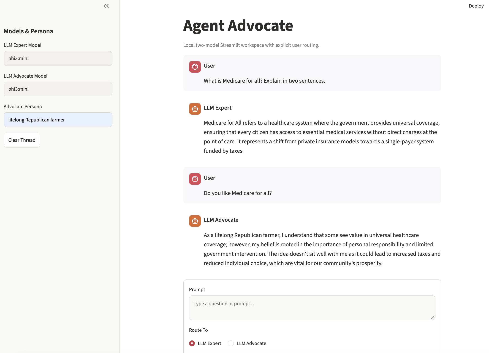

# Agent Advocate

Agent Advocate is a simplified prototype of a multi-agent, multi-user model designed to test how separating roles and keeping a human in the loop changes model behavior. Rather than asking a single model to act as an all-purpose arbiter where competing constraints flatten minority viewpoints, user prompts route explicitly between an unpersonified `LLM Expert` and a persona-configured `LLM Advocate` over local Ollama endpoints, with condensed conversation history used to reduce context burden and cross-role bleed.



In practice, the model keeps distinct perspectives steady in the conversation—such as pairing a direct factual response on Medicare for All with a bounded first-person trade-off from a lifelong Republican farmer—so human reviewers can inspect disagreements, audit assumptions, and steer deliberation rather than relying on an opaque single-agent summary.

## Setup & Run

```bash
mamba create -n agent-advocate python=3.11 streamlit requests -y
mamba activate agent-advocate

ollama serve
ollama pull phi3:mini
streamlit run llm_advocate.py
```
